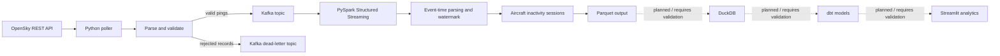

# 01 — Airlytics project overview

## 1. What this project is

**Airlytics is a local-first flight-telemetry data engineering and analytics project.** It collects aircraft state-vector observations from the OpenSky Network, normalizes them into a consistent event schema, publishes them to Apache Kafka, processes the stream with PySpark Structured Streaming, stores analytical output as Parquet, and is intended to expose useful metrics through DuckDB/dbt and a Streamlit dashboard.

The engineering goal is to demonstrate how raw, frequently arriving observations can be turned into data that is easier to query and analyze. The project is designed to run on a developer's machine. It does not require a deployed cloud data platform.

> **Status warning:** This document describes the repository as inspected, not a successful end-to-end run. Source files and configuration exist, but the complete local pipeline, dbt models, and dashboard integration still need runtime validation. Do not describe unverified stages as production-ready.

## 2. Problem statement

A flight-tracking API returns observations (state vectors), not a ready-made analytics dataset. Each observation can contain an aircraft identifier, callsign, country, timestamp, longitude, latitude, altitude, speed, heading, and other fields. The data may be incomplete: for example, an aircraft can have no current coordinates, or optional values can be null.

A useful analytics workflow therefore needs to:

1. Retrieve observations without overwhelming the external API.
2. validate and normalize inconsistent raw records.
3. retain enough timestamps to reason about when an event happened and when the system received it.
4. separate valid events from records that cannot be processed.
5. transport events reliably between ingestion and processing.
6. derive time-based summaries from the event stream.
7. store queryable analytical data and present meaningful metrics.

Airlytics is a learning project for these patterns. It is not an air-traffic-control system and should not be used for operational flight-safety decisions.

## 3. High-level architecture

The dotted downstream relationship is intentional: the repository contains pieces for DuckDB/dbt and a Streamlit dashboard, but the current models and data-provider path must be reconciled and tested before claiming that the whole route works.

## 4. Data flow, step by step

### Step 1 — Source: OpenSky REST API

The poller requests state vectors from OpenSky. The ingestion configuration can include a geographical bounding box, which limits the requested region. The API response is a snapshot of observations available at request time; it is not a complete historical flight record or an authoritative schedule.

### Step 2 — Ingestion and normalization

`ingest/main.py` creates an `IngestionConfig`, an `OpenSkyPoller`, and a `KafkaPingPublisher`. It repeatedly calls `poll_cycle()`, publishes valid pings, publishes rejected records to the dead-letter topic, and supports a bounded run duration and signal-based shutdown.

`ingest/poller.py` is responsible for the HTTP request/retry path and coordinates parsing. `ingest/models.py` defines the `NormalizedFlightPing` dataclass and maps the positional OpenSky state-vector fields into named fields. It checks the record shape, aircraft identifier, and coordinate presence/range. Records that fail parsing are represented as error dictionaries for dead-letter handling.

The canonical event includes both:
- `event_timestamp`: the timestamp associated with the observed aircraft state.
- `ingest_timestamp`: when this application normalized/received the record.

This distinction matters when measuring data freshness and late-arriving events.

### Step 3 — Kafka transport

`ingest/kafka_producer.py` serializes normalized pings and sends them to the configured Kafka topic. The message key is `icao24`, the aircraft identifier. Kafka partitioning by key helps keep records for the same aircraft ordered within a partition.

Rejected records are sent to a separate dead-letter topic. The local Docker Compose configuration uses the Apache Kafka image in KRaft mode; the host listener is exposed at `localhost:19092`, while containers use `kafka:9092`.

Kafka is the transport layer. It does not perform the analytical transformation itself.

### Step 4 — Stream processing with PySpark

`spark/streaming_pipeline.py` reads Kafka values as JSON, parses them using the schema in `spark/schemas.py`, converts the event timestamp to Spark timestamp type, and applies a 10-minute event-time watermark by default.

The current sessionization logic groups by aircraft identifier and a 15-minute inactivity-gap session window. It calculates fields such as session start/end, ping count, maximum barometric altitude, average velocity, and duration. The resulting rows are written in append mode to Parquet with a checkpoint directory.

These are **aircraft observation sessions**, not proven airport-to-airport flight legs. A 15-minute inactivity gap is a heuristic and should be evaluated against the data and intended analysis.

### Step 5 — Analytical storage and querying

Parquet is the intended local columnar storage format. DuckDB is configured as the local analytical database/profile target, and dbt is present for SQL transformations. However, the current dbt SQL contains BigQuery-specific syntax and functions (for example, BigQuery data types and geospatial functions). Those models are not yet evidence of a working DuckDB transformation layer.

Before treating this stage as complete, port the SQL to DuckDB-compatible SQL, define the correct sources, and run `dbt debug`, `dbt compile`, and `dbt build` against actual local files.

### Step 6 — Dashboard

`dashboard/app.py` is a Streamlit application for presenting airspace information and analytics. The inspected code includes a live OpenSky data path and a synthetic-data fallback. A fallback is useful for UI development, but it must be visibly labelled so demo data is not mistaken for real observations.

The dashboard should ultimately query the local analytical outputs rather than independently polling the API or silently switching to synthetic data. The current data-provider and model field contracts need verification before that claim is made.

## 5. Data layers in data-engineering terms

The following terminology is a useful way to explain the design. It is a conceptual mapping; do not assume that every layer is already implemented as a separate directory or persisted table.

| Layer | Meaning in Airlytics | Intended representation |
|---|---|---|
| Source / raw | API response and original state-vector values | Raw JSON or captured fixtures, where retained |
| Normalized / validated | Named fields, UTC timestamps, coordinate checks, rejected-record reasons | `NormalizedFlightPing` JSON events and DLQ records |
| Streaming / refined | Parsed Spark rows with event time and aircraft sessions | Spark DataFrames |
| Analytical / serving | Query-ready session and KPI tables | Parquet plus DuckDB/dbt models, after integration |

A classic **bronze / silver / gold** explanation can be used only if the repository actually persists and validates those layers:
- **Bronze:** source-faithful ingested records.
- **Silver:** cleaned, typed, deduplicated records with quality rules.
- **Gold:** business-facing aggregates and metrics.

At present, the code clearly demonstrates normalization, a dead-letter path, streaming transformations, and a Parquet sink. Do not claim a complete medallion architecture until raw retention, silver tables, gold marts, and their tests are implemented and demonstrated.

## 6. What can be measured

Once the end-to-end data path is validated, useful analytics include:

- Number of observed aircraft in a selected region and time window.
- Observation volume (pings) by minute or hour.
- Aircraft activity by callsign or ICAO24.
- Distribution of observed altitude and velocity.
- Session duration and observations per session.
- Data freshness: difference between ingestion time and event time.
- API health: request success rate, latency, rate-limit responses, and empty snapshots.
- Data quality: rejected-record rate and reasons.

Be careful with interpretation. A state-vector snapshot is not a unique flight. Counting pings does not count flights, and an inactivity-based session is not necessarily a real-world flight leg.

## 7. Why this stack

| Component | Responsibility | Why it is used here |
|---|---|---|
| Python | API ingestion and normalization | Straightforward HTTP, parsing, validation, and testability |
| Apache Kafka | Event transport and buffering | Separates the producer from downstream processing |
| PySpark Structured Streaming | Stateful/event-time stream processing | Demonstrates streaming transformations and session windows |
| Parquet | Local analytical files | Columnar storage that works well with analytical engines |
| DuckDB | Local analytical SQL engine | SQL over local files without operating a database server |
| dbt Core + dbt-duckdb | SQL model organization and tests | Makes transformation logic modular and reviewable |
| Streamlit | Dashboard UI | Fast way to build an interactive Python analytics interface |
| Docker Compose | Local service orchestration | Reproducible local Kafka environment |

These tools are not automatically better than alternatives. Their value here is educational: they let the project demonstrate ingestion, messaging, streaming, storage, modeling, and presentation while keeping the core runtime local.

## 8. Local runtime and cost boundary

The intended runtime is local:
- Kafka runs in Docker Compose.
- Python ingestion runs on the host or in a local environment.
- Spark runs in local mode unless deliberately configured otherwise.
- Parquet and DuckDB files live on local disk.
- Streamlit runs locally.

There is no need to provision Pub/Sub, Dataflow, BigQuery, Dataproc, or another paid cloud service for the local pipeline. Legacy cloud/Terraform folders may remain as historical reference; their presence does not mean they are part of the active local runtime.

“Free” does not mean zero resource use: Docker, Spark, and Kafka consume local CPU, RAM, disk, and electricity. OpenSky is an external dependency with its own access policies and limits. GitHub Actions usage can also become billable if account allowances are exceeded; keep workflows intentional and monitor usage.

## 9. Current implementation status

| Area | Repository evidence | Status to communicate |
|---|---|---|
| OpenSky polling | `ingest/poller.py`, `ingest/main.py` | Implemented in source; API behavior still needs a controlled live test |
| Normalization | `ingest/models.py` | Implemented in source; tests should be run |
| Kafka producer | `ingest/kafka_producer.py` | Implemented in source; delivery semantics and local connectivity need validation |
| Local Kafka | `docker-compose.yml` | Configuration exists; container startup not verified |
| Spark stream | `spark/streaming_pipeline.py` | Transformation and Parquet sink code exist; end-to-end run not verified |
| DuckDB/dbt | `dbt_airlytics/` | Partial; SQL models still need DuckDB compatibility work |
| Dashboard | `dashboard/app.py`, `dashboard/data_provider.py` | UI exists; integration with the processed analytical data needs verification |
| CI/CD | `.github/workflows/` | Inspect workflow triggers and run history; no cloud deployment should be assumed |
| Cloud infrastructure | `infra/`, `dataflow/`, `dataform/` | Legacy/reference unless explicitly reactivated |

## 10. A concise interview explanation

“Airlytics is a local-first streaming data engineering project built around aircraft telemetry. I ingest state-vector observations from the OpenSky REST API with Python, normalize and validate the records, and route invalid records to a dead-letter topic. Valid events are keyed by aircraft identifier and published to Apache Kafka. PySpark Structured Streaming consumes the topic, parses event timestamps, applies a watermark, and groups observations into inactivity-based aircraft sessions. The intended analytical output is Parquet, queried locally with DuckDB and modeled with dbt, with Streamlit as the presentation layer. I chose a local architecture to demonstrate the complete data flow without depending on paid cloud infrastructure. I distinguish the parts implemented in source from the downstream integrations that still need end-to-end validation.”

Only use this pitch after you can demonstrate each claimed stage. If the DuckDB/dbt/dashboard integration is not yet working, explicitly say it is the next integration step rather than implying it is complete.

## 11. Recommended validation sequence

1. Run ingestion unit tests and inspect parser edge cases.
2. Start Kafka with `docker compose up -d` and confirm broker health.
3. Create/list the expected topics and send a small known fixture.
4. Run the Spark job against that fixture; verify schema, timestamps, watermark behavior, checkpoint recovery, and Parquet output.
5. Read the Parquet output with DuckDB and check row counts and nulls.
6. Port and test dbt models using the DuckDB adapter.
7. Make the dashboard read those real local marts; make synthetic mode explicit.
8. Run a bounded live API test with conservative polling and record latency, volume, and errors.
9. Document reproducible commands and measured results before adding numeric performance claims to a resume.

## 12. Important terminology

- **State vector:** one observation of an aircraft's state at a point in time.
- **Event time:** when the observed event occurred, as represented by the source timestamp.
- **Ingestion time:** when the pipeline received/processed the event.
- **Watermark:** Spark's mechanism for tracking event-time progress and limiting how long it retains state for late data.
- **Session window:** a dynamic group of events separated by a configured inactivity gap.
- **Dead-letter queue/topic:** a separate destination for records that cannot be processed normally.
- **Checkpoint:** persisted streaming progress/state used by Spark to recover a query.
- **Idempotency:** designing writes so replaying the same event does not create duplicate analytical results.
- **Data mart:** a curated, query-friendly dataset designed for a particular analytical use case.
