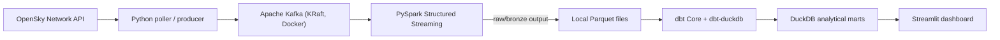

# Airlytics ✈️
### Free, local-first real-time flight telemetry and analytics

[](https://www.python.org/)
[](https://kafka.apache.org/)
[](https://spark.apache.org/)
[](https://www.getdbt.com/)
[](https://duckdb.org/)
[](https://www.docker.com/)

Airlytics turns public ADS-B flight-position data from the [OpenSky Network](https://opensky-network.org/) into useful flight and airspace analytics. It is designed to run on a developer's computer using free, open-source software. **The project does not require a Google Cloud account, a paid API, a managed Kafka service, or a cloud deployment.**

> **Cost rule: $0 project infrastructure.** Do not run Terraform against a cloud account, deploy cloud resources, or enable paid services for this project. OpenSky access is subject to its own fair-use limits and availability. GitHub-hosted Actions may have plan-specific usage limits; local checks are the default.

---

## Architecture



| Layer | Technology | Responsibility |
|---|---|---|
| Source | OpenSky REST API | Public flight state vectors |
| Ingestion | Python | Polling, normalization, validation, event publishing |
| Message broker | Apache Kafka (KRaft) | Durable local event buffer and replay |
| Stream processing | PySpark Structured Streaming | Event-time handling, watermarks, deduplication and 15-minute sessions |
| Data lake | Parquet on local disk | Low-cost, columnar raw/processed storage |
| Warehouse | DuckDB | Local analytical database |
| Transformations | dbt Core + dbt-duckdb | Staging, marts and data quality tests |
| Dashboard | Streamlit | Flight activity and route analytics |
| Runtime | Docker Compose + local Python | Reproducible local development |

No BigQuery, Cloud Storage, Dataproc, Dataflow, Pub/Sub, Cloud Run, Artifact Registry, or paid managed services are required.

## Quickstart

### Prerequisites
- Docker Desktop (or Docker Engine) and Docker Compose
- Python 3.11+
- Java 17+ (required by PySpark)
- Git

### 1. Clone and configure

```bash
git clone https://github.com/mivishvajeet/Airlytics.git
cd Airlytics
cp .env.example .env
```

### 2. Start the local broker

```bash
docker compose up -d kafka kafka-ui
```

Kafka UI: http://localhost:8080

### 3. Install Python dependencies

```bash
python3 -m venv .venv
source .venv/bin/activate
python -m pip install --upgrade pip
pip install -r ingest/requirements.txt
pip install -r spark/requirements.txt
pip install -r dashboard/requirements.txt
pip install dbt-core dbt-duckdb
```

### 4. Start the OpenSky producer

In a second terminal (with the virtual environment activated):

```bash
export STREAMING_SINK=kafka
export KAFKA_BOOTSTRAP_SERVERS=localhost:19092
export KAFKA_TOPIC=raw-flight-pings
python -m ingest.main
```

Respect OpenSky request limits. Keep the configured polling interval conservative; do not poll more frequently to try to obtain more data.

### 5. Start Spark

In a third terminal:

```bash
PYTHONPATH=. spark-submit \
  --packages org.apache.spark:spark-sql-kafka-0-10_2.12:3.5.0 \
  spark/streaming_pipeline.py \
  --kafka-bootstrap localhost:19092 \
  --topic raw-flight-pings \
  --sink parquet \
  --parquet-path data/bronze/flight-legs \
  --checkpoint-dir data/checkpoints/flight-legs
```

### 6. Transform and explore

After Spark has written Parquet files, configure dbt using the local profile example and run:

```bash
mkdir -p warehouse
cp dbt_airlytics/profiles.yml.example ~/.dbt/profiles.yml
dbt debug --project-dir dbt_airlytics
```

**dbt migration is not complete yet.** Existing SQL models still contain BigQuery-specific syntax and source declarations. Do not run `dbt build` against the DuckDB profile until those models and their source definitions have been ported and tested. This is an explicit remaining task, not a working feature.
```

Run the dashboard:

```bash
streamlit run dashboard/app.py
```

The dashboard's current data-provider implementation is still being migrated from its earlier prototype. Treat it as a UI prototype until the DuckDB-backed provider is completed; do not interpret synthetic fallback data as live pipeline output.

## Local commands

```bash
make up       # Start local Kafka and Kafka UI
make down     # Stop local containers
make logs     # Follow local service logs
make clean    # Stop services and remove local Kafka volume
```

`make clean` deletes the local Kafka data volume. It does not delete the Parquet data or DuckDB database.

## Repository map

```
Airlytics/
├── ingest/                 # OpenSky poller and Kafka producer
├── spark/                  # PySpark Structured Streaming
├── dbt_airlytics/           # dbt Core project (DuckDB target)
├── dashboard/              # Streamlit UI (provider migration pending)
├── data/                   # Local Parquet outputs and checkpoints (gitignored)
├── warehouse/              # Local DuckDB database (gitignored)
├── docker-compose.yml      # Local Kafka + Kafka UI
├── Makefile                # Local lifecycle commands
├── .env.example            # Safe local configuration defaults
├── infra/                  # Legacy GCP Terraform reference; do not apply
├── dataflow/               # Legacy Beam implementation; not in active path
└── dataform/               # Legacy Dataform implementation; not in active path
```

## Cost and safety guarantees

- All core compute and storage run locally.
- Kafka, Spark, DuckDB, dbt Core and Streamlit are used as local open-source tools.
- No cloud credentials are needed for the active local path.
- The GCP Terraform and Dataflow/Dataform directories are retained as historical learning material only. **Do not run `terraform apply` or the old cloud deployment workflow.**
- GitHub Actions is manual-only in this branch; running workflows on GitHub may consume the repository's included Actions allowance.
- OpenSky is an external data source, not an unlimited SLA-backed feed. Use conservative polling and comply with its current terms.

## Project status

This branch establishes the free local-first architecture and removes automatic cloud deployment. Remaining migration work includes completing the DuckDB-backed dashboard provider, validating the end-to-end Kafka → Spark → Parquet → dbt flow, and retiring obsolete cloud-specific code after tests pass.

See [the local runbook](docs/local-development.md) and [architecture decisions](DECISIONS.md).
