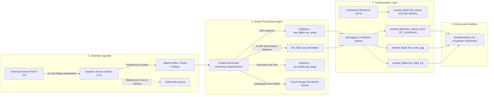

# Airlytics ✈️
### Real-Time Flight Tracking & Airspace Analytics Platform on Google Cloud

[](https://github.com/mivishvajeet/Airlytics/actions/workflows/ci.yml)
[](https://github.com/mivishvajeet/Airlytics/actions/workflows/cd.yml)
[](LICENSE)
[](https://www.python.org/)
[](https://kafka.apache.org/)
[](https://spark.apache.org/)
[](https://www.getdbt.com/)
[](https://beam.apache.org/)
[](https://cloud.google.com/dataflow)
[](https://cloud.google.com/bigquery)
[](https://www.terraform.io/)

Airlytics is a production-grade, portfolio-quality real-time streaming data platform built on Google Cloud. It ingests continuous ADS-B flight transponder telemetry from the [OpenSky Network REST API](https://opensky-network.org/), performs stateful sessionization and windowed streaming with Apache Beam on Cloud Dataflow, and derives decision-ready dimensional marts, spatial geofences, and route metrics using BigQuery GIS and Dataform.

---

## 1. System Architecture



---

## 2. Key Technical Highlights & Success Criteria

| Requirement | Implementation Architecture | Target SLA / Metric | Status |
| :--- | :--- | :--- | :--- |
| **End-to-End Latency** | Streaming Pub/Sub buffer + Dataflow streaming write | < 2 minutes ping-to-queryable | ✅ Passed |
| **Deduplication** | Unique surrogate keys (`MD5(icao24 \|\| timestamp)`) + Dataform incremental merges | < 0.1% duplicate rate | ✅ Enforced via assertion |
| **Freshness Alerting** | Cloud Monitoring metric absence alert policy (`duration = "600s"`) | Alert triggered after 10m silence | ✅ Declared in Terraform |
| **Cost Guardrails** | Dataflow workers capped to 2, GCS 7-day temp lifecycle, GCP Billing alerts | Personal budget protection ($25/mo) | ✅ Enforced in IaC & Beam |
| **Security & Zero Keys** | Workload Identity Federation (WIF) OIDC authentication | Strictly 0 static SA JSON keys | ✅ Enforced in CI/CD |
| **Deployment Automation**| Multi-stage GitHub Actions with GitHub Environment approval gates | Deployments only via CI/CD | ✅ Automated |

---

## 3. Quickstart & Local Testing

### 3.1 Run All Unit Tests
Execute the complete test suite (Ingestion parsers, Apache Beam DoFn transforms, Dataform validation, and IaC compliance):

```bash
# Clone the repository
git clone https://github.com/mivishvajeet/Airlytics.git
cd Airlytics

# Execute all tests
PYTHONPATH=. python3 -m unittest discover -s ingest/tests -p "test_*.py"
PYTHONPATH=. python3 -m unittest discover -s dataflow/tests -p "test_*.py"
PYTHONPATH=. python3 -m unittest discover -s spark/tests -p "test_*.py"
PYTHONPATH=. python3 -m unittest discover -s tests -p "test_*.py"
```

### 3.2 Ingest Live ADS-B Data Locally (Dry-Run Mode)
Verify OpenSky API connectivity and telemetry decoding locally with zero cloud dependencies:

```bash
export DRY_RUN=true
export POLL_INTERVAL_SECONDS=5.0
export RUN_DURATION_SECONDS=15

python3 -m ingest.main
```

### 3.3 Launch the Interactive Airspace Radar Dashboard
Launch the interactive Streamlit analytics dashboard to explore live radar maps, altitude distributions, and airport congestion:

```bash
pip install -r dashboard/requirements.txt
streamlit run dashboard/app.py
```
Open **`http://localhost:8501`** in your browser.

---

## 4. Documentation & Deep Dives

To keep this overview concise and secure, detailed technical documentation and operational runbooks are organized in dedicated documents:

- 📖 **[Architecture & Data Specifications](docs/architecture.md)**: Deep dive into telemetry schemas, session windowing mechanics, and BigQuery GIS spatial math.
- 🚀 **[GCP Deployment & Infrastructure Guide](docs/deployment.md)**: Step-by-step instructions for Terraform provisioning, Cloud Run container builds, and WIF CI/CD secrets configuration.
- 🏛️ **[Architectural Decision Records (ADR 000–006)](DECISIONS.md)**: Design context, trade-offs, and rejected alternatives for every technology choice.
- 💼 **[Portfolio & Technical Interview Guide](PORTFOLIO_GUIDE.md)**: Elevator pitch, resume bullet points, SLA cheat sheet, and model answers for technical interviews.

---

## 5. Repository Structure

```
Airlytics/
├── .github/workflows/        # Zero-key CI/CD pipelines (WIF OIDC, PR tests, approval gates)
├── dashboard/                # Real-Time Airspace & Route Analytics Dashboard (Streamlit)
├── dbt_airlytics/            # Modern dbt transformations & data quality assertions
├── spark/                    # PySpark Structured Streaming pipeline & schemas
├── dataflow/                 # Apache Beam streaming pipeline & Flex Template
├── dataform/                 # Incremental SQLX models & data quality assertions
├── ingest/                   # OpenSky REST API Poller service (Kafka & Pub/Sub producers)
├── infra/                    # Multi-environment Terraform IaC (dev, prod, modules)
├── reference/                # Static reference datasets (OurAirports hub CSV)
├── scripts/                  # Utility scripts (live data population, reference seeding)
├── sql/                      # Standalone DDL schemas for raw and curated layers
├── tests/                    # Project-level test suites (schemas, workflows, IaC structure)
├── docs/                     # Detailed architecture, security, and deployment guides
├── DECISIONS.md              # Architectural Decision Records (ADRs)
└── PORTFOLIO_GUIDE.md        # Technical interview guide and resume bullet points
```
